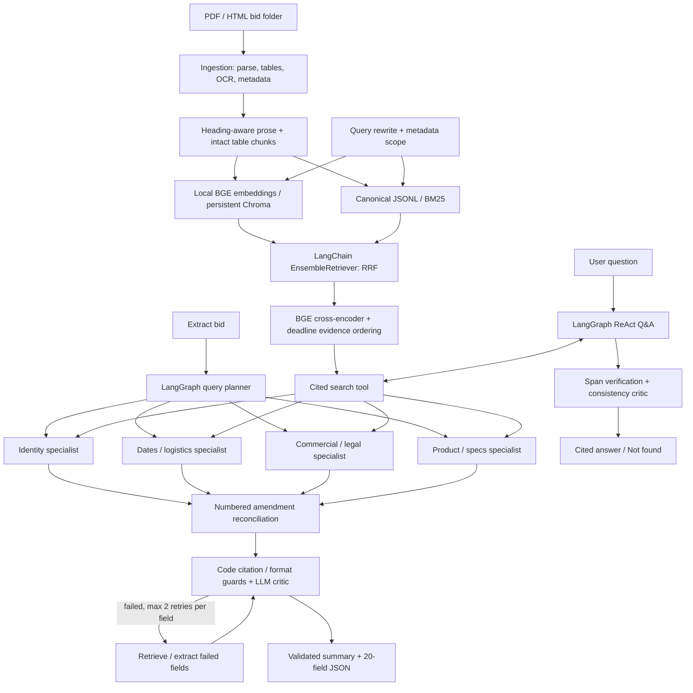

# RFP Intelligence Platform

A local hybrid search engine and LangGraph agent workflow for PDF/HTML procurement documents. Search returns cited passages; extraction produces 20 validated fields; Q&A generates evidence-backed answers. The CLI and FastAPI expose the same retrieval layer.

## Setup

Use Python 3.10+ (tested on Python 3.13/macOS). Run inside this directory:

```bash
python3 -m venv .venv
source .venv/bin/activate
python -m pip install -r requirements.txt
cp .env.example .env
python scripts/download_models.py
```

The model download needs internet and about 1.2 GB for the configured embedding/reranking weights. Exact Hugging Face snapshot revisions are saved in `index/models/registry.json`; subsequent model loading uses explicit local snapshots with `local_files_only=True`. `requirements.lock.txt` records the tested dependency versions; use it instead of `requirements.txt` to reproduce those versions.

Place one bid's PDF/HTML files in each `data/<bid_id>/` folder. Nested files are supported. The directory name supplies the bid ID; filename/content rules discover document types and numbered amendments. No bid-specific answers or filenames are hardcoded in runtime code.

For extraction/Q&A, edit the ignored `.env` locally:

```dotenv
LLM_PROVIDER=openai
OPENAI_API_KEY=your-key
OPENAI_MODEL=your-accessible-model-id
```

Use a model supporting tool calls and strict structured outputs. The verified live runs used `gpt-5.4-mini`; runtime model selection comes only from `.env`. OpenAI replaces the original Anthropic adapter with the user's approval. An Anthropic adapter (`LLM_PROVIDER=anthropic`, plus `pip install langchain-anthropic`) is written but **untested against the live API**; an Ollama adapter is not implemented. Each extraction call sends at most `agents.max_evidence_chars` (default 32000) characters of retrieved passages, lowest-ranked dropped first; output is capped by `LLM_MAX_OUTPUT_TOKENS` (default 32000, mostly consumed by model reasoning). The budget and cap were added after the last paid run and have not been re-verified end to end. Search, parsing, and evaluation use local models and need no LLM key. Extraction/Q&A send retrieved document passages to OpenAI; traces retain these passages locally. Keep `.env`, keys, input documents, and model weights out of source control.

Optional OCR uses the Tesseract executable, without a Python wrapper:

```bash
brew install tesseract
```

OCR is enabled in the supplied `config.yaml`. On other systems install Tesseract and English language data with the platform's package manager, or set `parsing.ocr_enabled=false`. Activate `.venv` in each terminal; macOS may have `python3` but no global `python` command.

## Run

After setup, extraction is one command and incrementally indexes the folder itself:

```bash
python main.py extract --bid ./data/Bid1
```

Additional modes:

```bash
python main.py ingest --bid ./data/Bid2
python main.py index --bid ./data/Bid2
python main.py search "submission deadline" --bid-id Bid1
python main.py search "what changed" --bid-id Bid1 --addendum-number 2 --full-text
python main.py search "processor memory storage" --bid-id Bid2 --doc-type specs --json
python main.py ask "What is the submission deadline after all addendums?" --bid-id Bid1
python main.py ask "Compare the warranty requirements of Bid1 and Bid2." --json
python eval/run_eval.py
python -m pytest -q
python -m pip check
```

`extract` writes `outputs/<bid_id>.json`, with exactly the 20 required field names, values, exact quotes, file/page citations, confidence, missing-value reasons, amendment changes, and validation counts. It exits nonzero when unresolved validation failures remain. Missing evidence is JSON `null` with `Not found in documents`; silence never proves a requirement is absent.

`search` returns passages, not generated answers. Use `--details` for ranking scores/timing and `--full-text` or `--json` for untruncated evidence. Modes are `vector`, `hybrid`, and `hybrid_rerank` (default). Filters include `--bid-id`, `--doc-type`, `--file-name`, `--page-number`, `--addendum-number`, and `--exclude-addenda`. Scores measure ranking, not answer probability.

`ask` accepts optional `--bid-id` and `--doc-type` filters. It returns a concise cited answer, evidence limits, and a trace path. Its JSON includes exact supporting quotes. Unsupported or unverifiable answers return `Not found in documents`.

## Web UI (bonus)

`python main.py serve`, then open http://127.0.0.1:8000. One plain HTML page (no extra dependency) with three tabs: **Search** (local, free), **Ask** (cited Q&A, paid LLM call; not re-tested after credits ran out) and **Extracted records** (saved `outputs/*.json` with sources). Search and records were checked in a browser.

## API

```bash
python main.py serve
```

Open [interactive API docs](http://127.0.0.1:8000/docs).

| Endpoint | Request |
|---|---|
| `POST /index` | `{"bid_dir":"./data/Bid1"}` |
| `GET /search` | `?q=deadline&bid_id=Bid1&top_k=3` |
| `POST /ask` | `{"question":"What is the final deadline?","bid_id":"Bid1"}` |
| `GET /health` | Process health; does not guarantee model readiness |

The API defaults to loopback. It is a local tool, with no authentication or production deployment hardening. Indexing/search use an OS file lock; current locking requires macOS/Linux (`fcntl`).

## Architecture



The compiled extraction graph is also in `outputs/extraction_graph.mmd`. Shared typed state holds the plan, evidence, base/amendment drafts, changes, validation, retries, and final record. Four specialist branches run concurrently; each field’s extraction sees a bounded set of retrieved passages in its document scope, with related equipment passages shared across model/part/product/specification fields; local CPU retrieval is serialized within a shared search instance. Planner, reconciliation, critic, and reporting have separate responsibilities. Ingestion and retrieval use deterministic code where an LLM adds no necessary value.

LangGraph makes fan-out, joining, conditional retries, and bounded termination explicit. Pydantic models define structured agent messages. Extraction uses `with_structured_output`; Q&A uses the requested `create_react_agent` with a real search tool. Tool evidence is seeded before answering and comparisons search each relevant bid separately.

## Design decisions

- **Parsing:** PyMuPDF4LLM per-page markdown; pdfplumber bordered-table fallback; conservative aligned code-column recovery for borderless inventories. A native-text length/word-retention check supplements major markdown omissions. Optional 300 DPI OCR recovers pages with almost no native text. All warnings are retained.
- **Chunking:** Markdown headings guide recursive prose splitting around 800 characters with 100 overlap. This keeps focused evidence while retaining local context. Physical pages stay separate for reliable citations. Each table remains one intact chunk, regardless of size; duplicate tables within a page are collapsed.
- **Embeddings:** local `BAAI/bge-small-en-v1.5` balances memory and semantic retrieval. Normalized embeddings use cosine search in Chroma. Snapshot revisions/config fingerprints prevent mixing incompatible vector spaces.
- **Keyword/fusion:** LangChain `BM25Retriever` (`rank_bm25`) preserves exact SKUs and hyphenated identifiers. `EnsembleRetriever` combines dense/lexical rankings with equal-weight RRF (c=60). Filters apply before both searches and again after fusion. Leading branch candidates are reserved before reranking.
- **Reranking:** `BAAI/bge-reranker-base` cross-encodes the candidate set. Long tables use overlapping internal scoring windows; stored/returned tables stay intact. Current-deadline queries prioritize concrete dated deadline statements and explicit applicable numbered revisions. Unrelated later amendments and historical queries are not promoted by that heuristic.
- **Incremental persistence:** canonical chunks/metadata persist in JSONL; BM25 is reconstructed per scope without pickles. Stable content/metadata IDs retain unchanged embeddings. Adding/changing a bid retains other bids. An interrupted vector update blocks reads until re-indexing repairs the affected bid.
- **Evidence guard:** the model selects a retrieved chunk ID and line span. Code copies exact text and verifies a whitespace-normalized substring against the same bid/file/physical page. Invented IDs, bad spans, or absent citations reject the value. This prevents quote rewriting from weakening verification.
- **Reconciliation:** retrieve base and every numbered amendment separately for each field; review applicability, then apply in ascending number order. Explicit replacements supersede old values; additions and clarifications preserve existing supported details. The latest applicable change wins. Main-RFP deadlines remain available for the change log even if the portal already reflects an extension.
- **Field coverage:** bounded supplemental searches use common section/table labels alongside planner queries. Related product/model/part/specification fields share retrieved equipment passages within the same amendment scope. Repeated boundary text is kept once so title cleanup does not erase every occurrence; page-number-only chunks are omitted.
- **Validation:** deterministic provenance/date/number checks precede an evidence-only semantic critic. Failed fields are retrieved/extracted again at most twice. Semantic verdicts are reused for identical field/evidence payloads so retrying one field does not randomly reopen unchanged validated fields. Summary generation runs last from validated fields, with its own review. Prompts distinguish vendor questions from binding answers, bid bonds from municipal funding, planned quote dates from delivery deadlines, and literal time-zone conflicts.
- **Observability:** per-node JSONL includes run ID, input, search calls, output, token usage where available, latency, and failure metadata. Known credential values are redacted; clients and headers are never serialized. Errors, bad structured output, timeouts, and empty retrieval use explicit fallbacks.

`langchain-classic` and `langchain-community` supply the exact Ensemble/BM25 integrations requested. Upstream deprecation notices are visible in tests. Embeddings/reranking run on CPU for consistent local behavior. Configuration uses JSON syntax, which is valid YAML, avoiding another parser dependency.

## Retrieval evaluation

24 manually anchored questions cover both bids, exact identifiers, dates, specifications, forms, amendments, and cross-bid evidence. A hit must contain the expected quote on the correct bid/file/physical page; page-only matches do not count. Equivalent citations for one fact count once. Question-level averages prevent multi-source questions from dominating.

| Configuration | Recall@1 | Recall@3 | Recall@5 | MRR@5 | Errors |
|---|---:|---:|---:|---:|---:|
| vector | 0.646 | 0.688 | 0.771 | 0.699 | 0 |
| hybrid | 0.604 | 0.812 | 0.812 | 0.722 | 0 |
| hybrid_rerank | 0.750 | 0.938 | 0.938 | 0.847 | 0 |

See `eval/questions.yaml`, `eval/results.md`, and `eval/results.json` for gold quotes, per-question results, model snapshots, fingerprints, and methodology. MRR is truncated at five. The reranked configuration includes the documented deadline ordering. This is a development set including earlier regressions, not held-out accuracy. One pre-bid anchor crosses chunk boundaries; one flat cross-bid warranty search misses a second bid's source. Both misses remain in the denominator. These metrics evaluate retrieval, not generated-answer accuracy.

## Independent public-RFP checks

Three public RFPs were reviewed independently and tested in isolated indexes: an eight-page Lesotho Communications Authority laptop RFP, a twelve-page Central Vermont Supervisory Union Chromebook RFP, and a fresh forty-two-page Beaumont ISD Chromebook RFP. Expected answers were written before live extraction and were never supplied to the agents. Source URLs/hashes, raw records, complete traces, runtime snapshots and unchanged-runtime/index checks are retained. These are historical documents, not current bidding opportunities.

First runs exposed real gaps, including false missing fields, incomplete equipment/documentation extraction, an unsupported brand used as a part number, and deadline formatting/zone omissions. First results are preserved in `outputs/public_lca_test/`, `outputs/public_cvsu_test/` and `outputs/public_beaumont_test/`. Subsequent fixes use general section/table-label searches, bounded same-page neighboring passages, shared equipment evidence, retained evidence during repairs, title preservation, explicit incomplete-deadline warnings, and field-specific completeness checks. Selected quotations are checked separately from completeness, so uncited facts in retrieved context cannot justify an assertion. Commercial model prose alone cannot establish a separate part number. Repairs remain capped at two retries. Later runs are development retests, not held-out evaluations.

### Narrowing step and latest public retest

Both earlier failures were the same pattern: most of a value was supported but one assertion was not, and the whole field was nulled. After the retries, the report step now asks the model to delete only the assertions the support reviewer named, then re-runs the same source-support check against the unchanged citations. Narrowed values get a note, confidence capped at 0.7, and cannot gain new facts. Completeness failures (omissions) are not narrowed.

Development retest (`outputs/public_cvsu_narrowed/`, `outputs/public_beaumont_narrowed/`; earlier folders preserved): Beaumont 16 populated / 4 missing / 0 failed; CVSU 13 / 6 / 1 failed. CVSU Installation is now populated with the supported assembly/servicing/demonstration requirements. A different CVSU field, Required documentation, was then rejected by the completeness review (it omitted the signed-proposal requirement), so CVSU still has one failure; live-model runs vary between runs. Null on a failed field means validation failure, not absence of the requirement. This is a development retest, not a held-out accuracy measure.

Read `outputs/public_rfp_review.md` for the comparison and remaining source-review findings. Workflow validation counts are not accuracy scores; exact quotations do not prove completeness or correct interpretation. Q&A can reformulate a failed search, so its useful answers do not imply every extraction field was recovered. No claim of reliable extraction for every unseen RFP is made.

The original Bid1/Bid2 outputs still pass the exact-citation audit against their preserved canonical index. The 24-question retrieval evaluation was rerun with the revised search runtime and retained the reported scores. This follow-up exercises revised parsing on the public documents; it does not regenerate the original two extraction records.

To reproduce the Beaumont development retest, place the source PDF at `data/Public_Beaumont_2025/chromebooks_rfp.pdf` using the URL in its manifest. Use the existing virtual environment and model cache. The isolated config refers to `index/public_beaumont_test`; copy `index/models/registry.json` into that index’s `models/` directory so it can reuse the already downloaded local weights. Then run:

```bash
python main.py extract --bid ./data/Public_Beaumont_2025 --config ./outputs/public_beaumont_corrected/config.json
```

This makes paid calls to the configured OpenAI model. Public input PDFs and index/model directories are excluded from the submission ZIP. Retain saved result folders before reproducing a run, as the command writes its output there. The saved runtime snapshot for each phase identifies the exact implementation used.

## Deliverables and verification

- `outputs/Bid1.json`, `outputs/Bid2.json`: live extracted records.
- `outputs/Bid1.trace.jsonl`, `outputs/Bid2.trace.jsonl`: complete extraction traces; `outputs/trace.jsonl` aggregates runs.
- `outputs/qa_log.md`, `outputs/qa_log.json`: ten live cited Q&A examples.
- `eval/`: evaluation questions, runner, measured report.
- `DEMO.md`: timed 5–10 minute walkthrough and explanation guide.
- `tests/`: parsing, chunking, fusion, persistence, filters, deadline ordering, citation guards, actual extraction-graph feedback, Q&A scope/fallback, and API validation.

To regenerate the saved Q&A examples, run `python scripts/run_qa_examples.py` (paid LLM calls). After both extractions and the Q&A run, `python scripts/verify_outputs.py` audits the 20-field contracts, full trace completion, exact citation provenance, and required cross-bid evidence. `python scripts/package_submission.py` creates `../rfp-intel-submission.zip` from an explicit deliverable list and checks for configured API-key text. The ZIP excludes original bid files, model weights, the index, `.env`, and `.venv`.

Offline tests inject deterministic model/search doubles and make no paid API calls. They establish mechanics and guard behavior; real-model evaluation and saved live runs establish the reported examples. `scripts/verify_checkpoint2.py` checks parsing/index/search with a renamed `data/Bid3_test` copy. This demonstrates filename independence, not generalization to genuinely unseen content. Extraction automatically handles another bid folder with the same command.

## Assumptions and limits

Physical one-based PDF pages can differ from printed page labels; HTML uses synthetic page 1. Issuing organization is `company_name`; manufacturer/registration fields remain null if no explicit manufacturer requirement is retrieved. Missing facts use confidence zero; populated confidence is an uncalibrated model estimate capped at .95, or .70 for OCR-backed values.

Exact citations establish provenance, not semantic truth. The critic and amendment decisions can still make errors; human source review remains necessary. Long table embeddings may truncate; lexical search sees full tables and reranking windows cover retrieved tables, but cannot recover absent candidates. Arbitrary borderless layouts, reading order, OCR accuracy, and overlapping native supplements remain limitations. Query expansion/deadline ranking use English heuristics. Time zones are preserved literally; ambiguous/conflicting zones are not silently corrected. Day-first dates and `11hr00` notation are supported. A source deadline without a time zone is retained with an explicit incomplete-deadline warning and confidence capped at .70; no zone is inferred from the issuer’s location.

OpenAI service/model availability and cost are external requirements for generated modes. Source documents, index, downloaded weights, `.venv`, and secrets are excluded from distribution. No web UI is required by the assignment; the CLI and FastAPI docs provide the interface. A live demo is the selected submission format; no recording is planned. Publishing the repository and presenting the live session remain submission steps. Address the independently observed extraction gaps before claiming broad unseen-document readiness.

License: **All rights reserved. Evaluation only.**

### Model reasoning configuration

For the tested `gpt-5.4-mini` model, the application requests medium reasoning; the provider default is none. Override with `OPENAI_REASONING_EFFORT` in the local `.env`. Other model names receive no reasoning override unless explicitly configured. See the [official model documentation](https://developers.openai.com/api/docs/models/gpt-5.4-mini). This setting improves deliberation but does not guarantee correct extraction.
